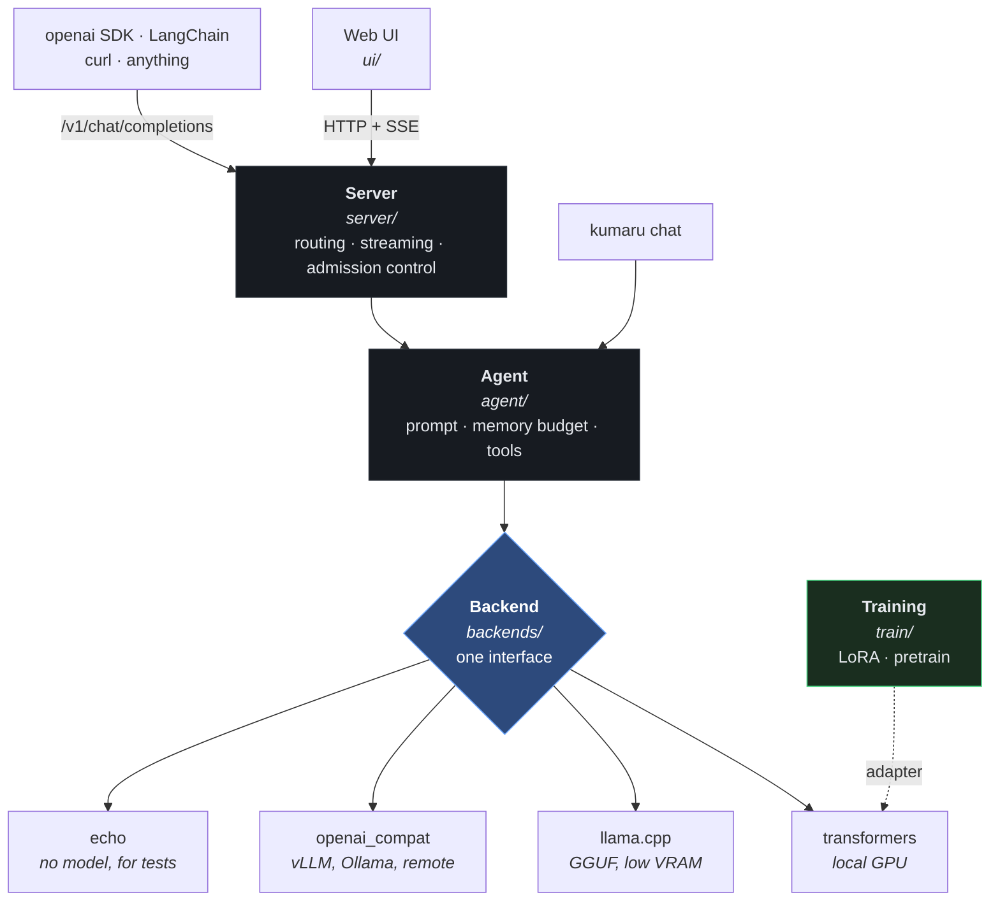

<div align="center">

# ◈ Kumaru

**A local-first LLM agent that scales with your hardware.**

Chat today on one GPU. Fine-tune tonight. Serve a cluster later — without rewriting anything.

</div>

---

## What this is

Kumaru is a complete, running LLM system you own end to end:

- **Chat** — a web UI and an OpenAI-compatible API, streaming, running entirely on your machine.
- **Train** — LoRA/QLoRA fine-tuning on a single consumer GPU, plus a from-scratch transformer trainer that scales to multi-GPU.
- **Measure** — an eval harness, so "is it better?" has a number attached.
- **Extend** — a plugin registry for backends and tools; new capabilities are additive, never surgical.

Every source file has a companion how-to in [`docs/howto/`](docs/howto/) explaining what it does, why it exists, how to operate it, how to extend it, and how it fails.

## What it is not

It does not train a frontier model from scratch. That costs millions of GPU-hours and no desktop will do it. What it *does* give you is the same architecture, the same training mechanics, and the same serving patterns the frontier labs use — sized to the hardware you have, and built so every layer can be swapped for a bigger one as your compute grows. [`docs/SCALABILITY.md`](docs/SCALABILITY.md) is honest about exactly where each ceiling sits.

---

## Sixty-second start

```powershell
.\scripts\setup.ps1           # creates .venv, installs base package
.\.venv\Scripts\Activate.ps1

kumaru serve -c test          # no model, no download — proves the install works
```

Open **http://127.0.0.1:8080**. You should get a streaming reply immediately.

Now the real thing:

```powershell
.\scripts\setup.ps1 -Gpu -Quant   # PyTorch CUDA + training stack
kumaru serve -c local-gpu         # downloads Qwen2.5-7B on first run (~15 GB)
```

Check everything works, layer by layer:

```powershell
.\scripts\verify.ps1          # fast: no GPU, no downloads
.\scripts\verify.ps1 -Full    # also exercises CUDA, LoRA, and eval
```

Full walkthrough with troubleshooting: [`docs/QUICKSTART.md`](docs/QUICKSTART.md).

---

## The six commands

| Command | What it does |
|---|---|
| `kumaru serve` | Web UI + OpenAI-compatible API |
| `kumaru chat` | Terminal REPL, no server in between |
| `kumaru info` | Versions, GPU, which optional components are installed |
| `kumaru config` | Print the fully merged configuration — run this when something ignores your settings |
| `kumaru train` | LoRA fine-tune or from-scratch pretrain |
| `kumaru eval` | Latency, throughput, and quality regression checks |

---

## Pick a profile for your hardware

| Your machine | Profile | Command |
|---|---|---|
| 24 GB GPU (3090/4090) | `local-gpu` | `kumaru serve -c local-gpu` |
| 8–12 GB GPU | `low-vram` | `kumaru serve -c low-vram` |
| No GPU | `cpu-only` | `kumaru serve -c cpu-only` |
| Many users / a real server | `vllm` | `kumaru serve -c vllm` |
| Just testing the code | `test` | `kumaru serve -c test` |

Every profile is a commented YAML file in [`configs/`](configs/). They are meant to be read.

---

## The architecture in one picture



The blue box is the load-bearing idea. Everything above it is written once; everything below it is interchangeable. Upgrading from a 7B on your desktop to a 70B on a cluster is a change to a YAML file.

---

## Documentation

Start here, in this order:

| Document | What it answers |
|---|---|
| [`docs/QUICKSTART.md`](docs/QUICKSTART.md) | Get it running on my machine, right now |
| [`GUIDE.md`](GUIDE.md) | How do I actually *use* this as a tool, day to day |
| [`docs/TRAINING.md`](docs/TRAINING.md) | How do I train it, what does it cost, what should I expect |
| [`docs/SCALABILITY.md`](docs/SCALABILITY.md) | Where are the ceilings, and what do I do at each one |
| [`docs/ARCHITECTURE.md`](docs/ARCHITECTURE.md) | Why is it built this way |
| [`docs/howto/`](docs/howto/) | One page per source file — API, usage, extension points, failure modes |

---

## Layout

```
src/kumaru/
  core/        config, types, errors, logging, plugin registry
  backends/    inference engines behind one interface
  agent/       prompt assembly, memory budgeting, tool seam
  server/      FastAPI, OpenAI-compatible, SSE streaming
  train/       LoRA fine-tuning + from-scratch transformer
  eval/        speed and quality measurement
ui/            zero-build web client (3 files, no npm)
configs/       hardware profiles and training recipes, heavily commented
scripts/       setup.ps1 (install) and verify.ps1 (layered self-check)
docs/howto/    a page for every source file
tests/         pytest suite, runs with no GPU in ~3 seconds
```

## Requirements

- Python 3.10+
- Optional: an NVIDIA GPU. 8 GB gets you a quantized 7B; 24 GB gets you a comfortable 7B *and* QLoRA fine-tuning.
- No GPU is fine — use `-c cpu-only`.

## License

MIT.
