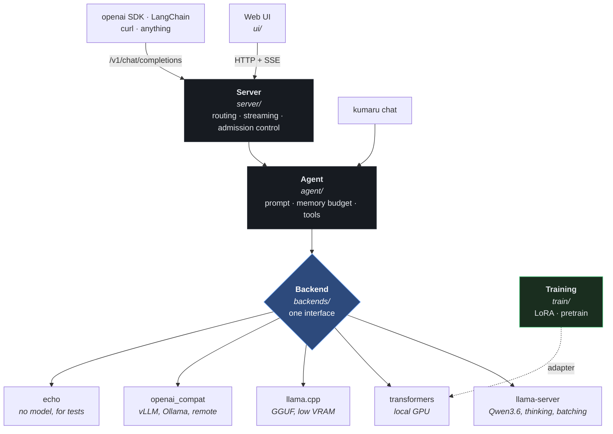

<div align="center">

# ◈ Kumaru

**A local-first LLM agent that scales with your hardware.**

Chat today on one GPU. Fine-tune tonight. Serve a cluster later — without rewriting anything.

</div>

---

## What this is

Kumaru is a complete, running LLM system you own end to end:

- **Chat** — a web UI and an OpenAI-compatible API, streaming, running entirely on your machine. On a 24 GB GPU the default model is Qwen3.6-35B-A3B, with an optional **Think** mode for hard problems.
- **Train** — LoRA/QLoRA fine-tuning on a single consumer GPU, plus a from-scratch transformer trainer that scales to multi-GPU.
- **Measure** — public benchmarks (`kumaru bench`) with confidence intervals and significance tests, plus a fast eval harness, so "is it better?" has a number attached.
- **Extend** — a plugin registry for backends, tools and benchmarks; new capabilities are additive, never surgical.
- **Code and learn** — opt-in `coder` guidance for cross-platform development, Playwright,
  Windows CLI and APIs; `kumaru learn` imports reviewed local references for new languages
  and platforms without changing model weights.

Every source file has a companion how-to in [`docs/howto/`](docs/howto/) explaining what it does, why it exists, how to operate it, how to extend it, and how it fails.

## What it is not

It does not train a frontier model from scratch. That costs millions of GPU-hours and no desktop will do it. What it *does* give you is the same architecture, the same training mechanics, and the same serving patterns the frontier labs use — sized to the hardware you have, and built so every layer can be swapped for a bigger one as your compute grows. [`docs/SCALABILITY.md`](docs/SCALABILITY.md) is honest about exactly where each ceiling sits.

---

## Sixty-second start

```powershell
.\scripts\setup.ps1           # creates .venv, installs the package and its test tools
.\.venv\Scripts\Activate.ps1

kumaru serve -c test          # no model, no download — proves the install works
```

Open **http://127.0.0.1:8080**. You should get a streaming reply immediately.

Now the real thing, on an NVIDIA GPU with 24 GB:

```powershell
.\scripts\get-llama-server.ps1    # llama.cpp's inference server, once; no PyTorch needed
kumaru serve -c qwen36            # Qwen3.6-35B-A3B; downloads 17.7 GB on first run
```

For fine-tuning, or a smaller GPU, add PyTorch:

```powershell
.\scripts\setup.ps1 -Gpu -Quant   # PyTorch CUDA + training stack
kumaru serve -c local-gpu         # downloads Qwen2.5-7B on first run (~15 GB)
```

Check everything works, layer by layer:

```powershell
.\scripts\verify.ps1          # fast: no GPU, no downloads
.\scripts\verify.ps1 -Full    # also exercises CUDA, LoRA, and eval
```

Full walkthrough with troubleshooting: [`docs/QUICKSTART.md`](docs/QUICKSTART.md).

---

## The commands

| Command | What it does |
|---|---|
| `kumaru serve` | Web UI + OpenAI-compatible API |
| `kumaru chat` | Terminal REPL, no server in between. `--workspace DIR` lets it create and edit files and run builds and tests in that folder, with your yes for each change and command |
| `kumaru info` | Versions, GPU, which optional components are installed |
| `kumaru config` | Print the fully merged configuration — run this when something ignores your settings |
| `kumaru train` | LoRA fine-tune or from-scratch pretrain |
| `kumaru eval` | Latency, throughput, and quality regression checks |
| `kumaru bench` | Public benchmarks with error bars; compares two runs with significance tests |
| `kumaru distill` | Turns a large model's graded answers into training data for a small, fast one ([how](docs/TRAINING.md#part-3--distillation)) |
| `kumaru learn` | Create a versioned local reference pack for a language or platform |

---

## Pick a profile for your hardware

| Your machine | Profile | Command |
|---|---|---|
| 24 GB GPU (3090/4090) | `qwen36` (**recommended**) | `kumaru serve -c qwen36` |
| 24 GB GPU, fine-tuning | `local-gpu` | `kumaru serve -c local-gpu` |
| 8–12 GB GPU | `low-vram` | `kumaru serve -c low-vram` |
| No GPU | `cpu-only` | `kumaru serve -c cpu-only` |
| Many users / a real server | `vllm` | `kumaru serve -c vllm` |
| Just testing the code | `test` | `kumaru serve -c test` |

Every profile is a commented YAML file in [`configs/`](configs/). They are meant to be read.

### Coding assistant and on-demand learning

```powershell
kumaru chat -c coder
kumaru serve -c coder           # the same guidance in the API and web UI
```

The `coder` profile uses the default Qwen2.5-7B transformers backend. It needs the
PyTorch extra and appropriate hardware. With another hardware profile (for example
`qwen36`), enable the same guidance without replacing its backend:

```powershell
$env:KUMARU_AGENT__EXPERTISE = '[coding, playwright, windows, apis]'
kumaru serve -c qwen36
```

Guidance covers idiomatic code, testing, Playwright locators/fixtures/traces,
Windows shell/version differences, remoting, and secure HTTP/HTTPS/API integration.
It does **not** install browsers, grant shell or remote access, or make a model an
expert in every technology.

To let the agent write the code and run it, give it a project folder in the terminal
chat. It needs a backend that calls tools, such as `qwen36`; the transformers
profiles, `coder` included, cannot:

```powershell
kumaru chat -c qwen36 --workspace C:\projects\my-app
```

It can then list, read, create and edit files in that folder, and run `python`,
`node`, `npm`, `npx` and `dotnet` there, never a shell. It shows you each change as a
diff and each command line first, and does it only if you answer `y`. Paths outside
the folder are refused, but approved commands run with your permissions, so read them.
The server and web UI never offer these tools, because they cannot ask
([details](docs/howto/src/kumaru/cli.md#let-it-work-in-a-project-folder-kumaru-chat---workspace)).

To add a new language or platform, save reviewed, version-specific documentation,
examples and test results in a UTF-8 text file, then import it:

```powershell
kumaru learn Rust --version 2024 --source C:\references\rust.txt --output C:\references\rust.json
$env:KUMARU_AGENT__KNOWLEDGE_FILES = '["C:/references/rust.json"]'
kumaru chat -c coder
```

The output directory must already exist; existing files are never overwritten.
Alternatively set `agent.knowledge_files` to absolute JSON paths in your YAML.
Packs load at chat/server startup, so restart after changing them. They include
topic, version, source filename and content. Record official source URLs and
review dates inside your source text; no network retrieval happens automatically.
References are labeled as untrusted data, not executable instructions; this is
model guidance, not a guaranteed prompt-injection defense. Never import secrets
or unreviewed material. With remote inference, references go to that backend
along with the prompt.

`agent.max_knowledge_chars` bounds **all** reference text together (default 6000;
0 disables it). This is prompt context, not semantic retrieval: put the most
relevant pack first, keep notes focused, and raise the budget only when your
model context allows it. Over-budget engineering prompts fail rather than being
sent to the model; reduce references or increase the context/history budget.

For actual on-demand weight training, use the existing [LoRA workflow](docs/TRAINING.md):
curate verified conversation examples, hold out independent coding tasks, validate
with `kumaru train <recipe.yaml> --dry-run`, train explicitly, compare held-out
results, and load the adapter with `--adapter` on the matching transformers base
model. Do not train on unchecked model-generated answers or deploy an adapter
without measuring regressions. `kumaru learn` does not perform fine-tuning.

Windows guidance includes Windows 7 onward, but runtime support is separate:
modern Python and Playwright do not support all post-Vista releases. Check the
specific OS/tool versions; use a supported development host for legacy targets.

---

## The architecture in one picture



The blue box is the load-bearing idea. Everything above it is written once; everything below it is interchangeable. Upgrading from a 7B on your desktop to a 70B on a cluster is a change to a YAML file.

---

## Documentation

Start here, in this order:

| Document | What it answers |
|---|---|
| [`docs/QUICKSTART.md`](docs/QUICKSTART.md) | Get it running on my machine, right now |
| [`GUIDE.md`](GUIDE.md) | How do I actually *use* this as a tool, day to day |
| [`docs/TRAINING.md`](docs/TRAINING.md) | How do I train it, what does it cost, what should I expect |
| [`docs/BENCHMARKS.md`](docs/BENCHMARKS.md) | How good is it really, and did my change help? Measured results and method |
| [`docs/SCALABILITY.md`](docs/SCALABILITY.md) | Where are the ceilings, and what do I do at each one |
| [`docs/ARCHITECTURE.md`](docs/ARCHITECTURE.md) | Why is it built this way |
| [`docs/howto/`](docs/howto/) | One page per source file — API, usage, extension points, failure modes |

---

## Layout

```
src/kumaru/
  core/        config, types, errors, logging, plugin registry
  backends/    inference engines behind one interface
  agent/       prompt assembly, memory budgeting, tool loop, project-folder tools
  server/      FastAPI, OpenAI-compatible, SSE streaming
  train/       LoRA fine-tuning + from-scratch transformer
  eval/        speed and quality measurement; public benchmarks (eval/benchmarks/)
ui/            zero-build web client (3 files, no npm)
configs/       hardware profiles and training recipes, heavily commented
data/          sample training data and the golden benchmark questions
scripts/       setup.ps1 (install), verify.ps1 (layered self-check),
               get-llama-server.ps1 (inference engine), check_graders.py (grader proof)
docs/howto/    a page for every source file
tests/         pytest suite (783 tests), runs with no GPU in under a minute
```

## Requirements

- Python 3.10+
- Optional: an NVIDIA GPU. 8 GB gets you a quantized 7B; 24 GB gets you Qwen3.6-35B-A3B, or a comfortable 7B *and* QLoRA fine-tuning.
- No GPU is fine — use `-c cpu-only`.

## License

MIT.
