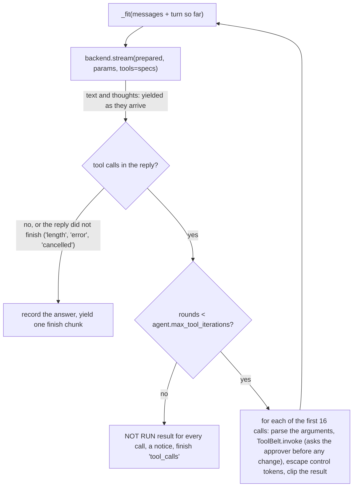

# `src\kumaru\agent\chat.py`

> `ChatAgent` is the stateless per-turn orchestrator. It resolves the decoding parameters (`generation` < `thinking_mode` < per-call overrides), fits the history into the context budget, calls the backend, runs the tools the model calls (asking the approver before any change), and logs timing.

**Read this when:** you change how a turn is assembled or decoded, you debug "why did the model see this prompt" or "why did it decode with these settings", you wire a new caller to a backend, you work on the tool-call loop, or you reason about history, reasoning traces or horizontal scaling.

---

## What it does

`ChatAgent(backend, config, *, approver=None)` wraps a `Backend` and a `KumaruConfig`. Each `complete()` or `stream()` call runs these steps:

1. **Resolve parameters.** `resolve_params(**overrides)` layers `config.generation`, then `config.thinking_mode` (only when thinking resolves on), then the per-call overrides.
2. **Prepare the prompt.** `prepare(messages, extra_context=..., reserve_tokens=params.max_tokens)` does three things:
   - builds the system prompt (`agent\prompt.py`), including any reference packs (`agent\knowledge.py`);
   - forces exactly one system message, at index 0;
   - trims the history with the configured memory policy (`agent\memory.py`) to fit the budget.

   It then trims `max_tokens` to the room the prepared prompt leaves in the context window.
3. **Generate.** `backend.generate()` for `complete()`, `backend.stream()` for `stream()`.
4. **Run tools, if any are offered.** The tool declarations go with the request. When the model replies with tool calls, the agent runs each one through `ToolBelt.invoke()`, which asks the approver first for anything that would change something. It escapes the chat control tokens in the results, appends them and goes back to step 2, for at most `agent.max_tool_iterations` rounds (see "The tool loop" below).
5. **Log.** It writes one INFO line on the `agent.chat` logger with token counts and timing.

The agent stores no conversation. Its state is set in `__init__`:

- `backend`;
- `config`;
- `memory`: `get_policy(config.agent.memory_policy)`;
- `tools`: `ToolBelt(config.agent.enabled_tools, workspace=config.agent.workspace, approver=approver)`. Without an approver, tools that change things and the project-folder tools are withheld, with a warning (`agent\tools.md`);
- `knowledge`: `[load_pack(Path(p)) for p in config.agent.knowledge_files]` (`agent\knowledge.py`);
- privately, the tool declarations it sends (`_specs`) and their estimated size in tokens (`_tool_tokens`).

`__init__` never loads the backend; it only asks `backend.check_tools()` whether the backend can pass tools to its model. So every caller constructs the agent *before* `backend.load()`. A bad knowledge pack or tool name, a missing project folder, or a backend that cannot call tools then fails before the model takes any memory:

| Caller | Uses | Per-call overrides passed |
|---|---|---|
| `src\kumaru\server\app.py` / `routes_chat.py` | `complete()` and `stream()`; `describe()` for `GET /v1/info`. No approver, so only read-only tools are offered. | The request's sampling fields (`ChatCompletionRequest.generation_overrides()`). |
| `src\kumaru\cli.py` (`kumaru chat`) | `stream(history, transcript=turn, **overrides)`, with `approver=_approve`, the y/N prompt. The only caller that can offer tools that change things. | `temperature`, `max_tokens`, `thinking`, `thinking_budget` from the flags, with every message. A flag left out is `None`, so the presets apply; see "CLI flags" below. |
| `src\kumaru\eval\harness.py` (`kumaru eval`) | `complete()`, no approver. | `temperature=0.0`, plus `max_tokens` from the case. |
| `src\kumaru\eval\benchmarks\runner.py` (`kumaru bench run`) | `resolve_params()`; `prepare()` only with `--use-agent-prompt`. No approver. | `thinking`, `thinking_budget`, `temperature`. It calls the backend directly. |

## Why it exists

- **Policy here, mechanism in the backend.**
  - Backends own tokenization, chat templates and transport.
  - The agent owns the system prompt, the history budget, the decoding presets and the telemetry.
  - Otherwise five backends would each re-implement the same policy and drift apart.
- **Stateless on purpose.**
  - Like the OpenAI API, the caller sends the full history on every turn. Any replica can serve any request, so you scale by adding processes behind a load balancer, with no session affinity.
  - Persistence belongs to the caller. The UI keeps history in `localStorage`; the CLI keeps it in a local list.
- **Two sampling presets, not one.**
  - Reasoning models are tuned to decode differently when they think. `configs\qwen36.yaml` uses Qwen's recommended presets (its comments cite the model card): temperature 0.7 and `top_p` 0.8 without thinking, 1.0 and 0.95 with it.
  - A single `generation` block cannot serve both modes. So `thinking_mode` holds the thinking preset, and it applies only when thinking is on.
- **`resolve_params` is public** so that the benchmark runner decodes exactly the way chat does. A benchmark score is only meaningful for the configuration that users actually run.
- **`prepare` is public and pure** so that tests can assert on the exact prompt without running a model. That is the fastest way to catch the bug class "the model is fine, but the prompt is wrong".
- **The approver comes from the caller.** Only the caller knows whether a person is there to answer. The loop is the same everywhere; what it offers depends on whether it was given an approver, so an interface that cannot ask can never change a file or run a program.

## Mental model

### Parameter precedence

`resolve_params(**overrides)` layers three sources, lowest to highest:

1. **`config.generation`.** It is already the merge of field defaults < YAML < `KUMARU_GENERATION__*` env vars (`core\config.md`). No CLI flag writes it.
2. **`config.thinking_mode`.** Only its non-`None` fields, and only if thinking resolves on.
3. **`overrides`.** Only non-`None` values. `GenerationParams.merged()` drops `None`, so callers can pass optional request fields straight through.

Thinking resolves to `overrides["thinking"]` when that is not `None`, and to `generation.thinking` otherwise:

| `overrides["thinking"]` | `generation.thinking` | `thinking_mode` applied | Resulting `params.thinking` |
|---|---|---|---|
| `True` | any | yes | `True` |
| `False` | any | no | `False` |
| absent or `None` | `True` | yes | `True` |
| absent or `None` | `False` | no | `False` |
| absent or `None` | `None` | **no** | `None`: nothing is sent, and the model's chat template decides. |

The last row is a trap for models whose chat template thinks by default, as Qwen3's does. Such a model can think while it decodes with the non-thinking preset and `max_tokens`.

`configs\qwen36.yaml` avoids this:

- It pins `generation.thinking: false` (its comment says "fast by default").
- Thinking is opt-in: `--think`, the UI toggle, or a request field.

Every other shipped profile leaves `generation.thinking` as `None` and `thinking_mode` empty, so there the question does not arise.

### CLI flags

`kumaru chat` sends `-t`, `--max-tokens`, `--think/--no-think` and `--thinking-budget` with every message, as `agent.stream(history, **overrides)`, the same way the UI sends its settings. So a flag beats both presets: `generation` and, on a thinking turn, `thinking_mode`. Verified with the echo backend, which reports what it received (all with `kumaru chat -c qwen36 -b echo -q "hi"`):

| Flags | Decodes with |
|---|---|
| `--think -t 0.3 --max-tokens 100` | `max_tokens=100, temperature=0.3` |
| `--no-think -t 0.3 --max-tokens 100` | `max_tokens=100, temperature=0.3` |
| `--think` | `max_tokens=32768, temperature=1.0`: the `thinking_mode` preset |

The other flags (`-c`, `-b`, `-m`, `--device`, `--adapter`, `--context`) are config overrides: they choose and load the model once, at start-up.

### The history budget

```text
reserved   = reserve_tokens if reserve_tokens is not None else config.generation.max_tokens
reserved   = min(reserved, backend.context_length // 2)
budget     = min(config.agent.max_history_tokens, max(512, backend.context_length - reserved - 128 - tool_tokens))
# after prepare(), in _fit():
max_tokens = min(max_tokens, max(1, backend.context_length - count_tokens(prepared) - tool_tokens))
```

- **Tool declarations take room too.**
  - `tool_tokens` is 0 when no tools are offered. Otherwise it is `len(json.dumps(specs)) / 3 + 150`: the chat template renders the declarations into the prompt, so they use the window like any message.
  - Measured: `current_time` alone costs 273 tokens. `kumaru chat --workspace` (the five project-folder tools) costs about 1,500, a little more for a longer `allowed_commands` list, since `run_command` lists the allowed programs.
- **Reserved room.**
  - `complete()` and `stream()` pass `reserve_tokens=params.max_tokens`, the *resolved* value. A thinking turn therefore reserves `thinking_mode.max_tokens`, not `generation.max_tokens`.
  - The room for the reply has to be reserved up front: a prompt that fills the window leaves nothing to generate into.
  - **At most half the window is reserved.** `max_tokens` is a ceiling, not a forecast; most replies stop far below it. Reserving qwen36's 32,768-token cap in full in a 32,768-token window would leave history only the 512-token floor.
- **The reply cap is trimmed to the room actually left.** Strict servers (vLLM, OpenAI) reject a request whose prompt plus `max_tokens` exceeds the window, instead of stopping at its end. So the reply gets whatever the history did not use.
- **Margin and floor.**
  - 128 tokens is a fixed margin, and 512 is a floor. With the half-window cap, the floor only matters for windows under 1,280 tokens.
  - Example, measured with the echo backend: `qwen36` and a 10-exchange chat of ~1,000-token messages. With `--context 32768` the budget is 16,256 tokens: the system prompt and the last 16 of 21 messages are kept (~15,300 tokens), and the reply cap drops from 32,768 to 17,490. At the default 131,072 window the budget is 65,536 (`max_history_tokens`): all 21 messages are kept and the cap stays 32,768.
- **The system prompt counts.**
  - The budget covers the whole list, including the system prompt. For the `test` profile, the system prompt alone is about 215 tokens by the heuristic.
  - The policy always keeps the system message. What else survives depends on the policy (`agent\memory.md`).
  - With `memory_policy: none`, an over-budget conversation raises `ContextLengthExceededError`.
- **Token counts come from `backend.count_tokens()`.**
  - Exact for `transformers` (it renders the chat template) and for `llamacpp` (the model tokenizer).
  - `echo`, `openai_compat` and `llamacpp_server` use a heuristic of about 3.6 characters per token. It counts a message's `tool_calls` too, since they are sent back with it.
- **Trimming keeps tool conversations valid.** The memory policy keeps the newest messages, so the cut can fall between a call and its results, or drop the user's request in a long tool loop. `_keep_well_formed()` then repairs the prompt:
  - it drops results that answer no call, since servers reject them;
  - it puts the latest user message back;
  - when the latest round's results alone outgrow the budget, the policy keeps only some of them (or, with `drop_oldest`, nothing but the system prompt). The whole round goes back after the request. For example, two results of 16,000 characters (`agent.workspace.max_output_chars`) are about 8,900 tokens, over the default `max_history_tokens` of 6,144.

  Whenever it puts messages back, it shortens the tool results in the prompt, keeping their start and end, until the prompt fits or each result is down to 400 characters. The transcript keeps the results whole.

### Reasoning and history

- **Where thoughts arrive.**
  - `complete()` returns a `ChatResult` whose `message.reasoning` holds the thought text. It is `None` when there was none.
  - `stream()` yields `StreamChunk`s with thought text in `chunk.reasoning` and answer text in `chunk.delta`. A chunk can carry both.
- **The agent keeps neither. Callers keep answers only:**
  - the CLI appends the turn's `transcript`: the answer, plus any tool calls and their results. The agent builds those messages from the deltas, without the thoughts;
  - the UI sends `{role, content}` and nothing else;
  - the server drops inbound `reasoning_content` (`ChatMessageIn` ignores unknown fields).
- **Thoughts are not carried across tool rounds either.** Each round's request holds the earlier rounds' calls and results, but not their thoughts. A thinking model therefore re-plans after every round from what it did, not from what it thought.
- **A kept thought is inert.**
  - `count_tokens()` and `Message.to_openai()` (default `include_reasoning=False`) read `content` only. So a stored thought is neither budgeted nor sent.
  - What is counted is what is sent.
- **Why answers only.**
  - Model authors train multi-turn behaviour on histories whose earlier assistant turns hold final answers, not thoughts. Qwen3's chat template strips old `<think>` blocks itself, and its model card says history should keep only the final output.
  - Thoughts are usually much longer than answers. Resending them would push real conversation out of the budget and add prefill time to every turn.

### Streaming lifecycle

- **Nothing runs until the first iteration.**
  - `stream()` is an async generator. Neither `resolve_params` nor `prepare` runs until the first `__anext__()`.
  - So a `ContextLengthExceededError` surfaces on the first iteration, not at the call.
  - In the server that moment is after the 200 headers have gone out, so the error arrives as an SSE error frame instead of a 413 (`server\routes_chat.md`).
- **TTFT.**
  - It runs from the first iteration of `stream()` (so it includes `prepare()`) to the first chunk whose `delta` *or* `reasoning` is non-empty. With thinking on, that is the time to the first thought, which is what the user sees as "it started".
  - With tools, a model may call a tool before it writes any text. TTFT then includes that tool round: the tool's run time, and how long the user took to approve it.
  - The server measures its own `stats` separately, and they include queueing.
- **The `streamed:` log line.**
  - Format: `streamed: <n> chunks in <ms>ms (ttft <ms>ms)`.
  - It counts chunks that carry text, not tokens, over all tool rounds.
  - It is written only when the stream runs to the end. A consumer that stops early (`break`, client disconnect) produces no line.
  - `ttft -1` means no text chunk arrived.
- **The `completed:` log line.** Without tools, `complete()` logs `completed: <p> prompt + <c> completion tokens in <ms>ms (<x> tok/s)` from the `ChatResult`. `Backend.generate()` estimates the usage when the backend reported none. With tools, `complete()` runs the stream loop, so the `streamed:` line is written instead.

### The tool loop

The loop runs only when tools are offered: `agent.enabled_tools` is not empty, after the `ToolBelt` has withheld what this caller cannot approve. Without tools, `stream()` re-yields the backend's chunks unchanged and nothing below applies.



- **One round.**
  - The model's reply is streamed; its text and thoughts reach the caller as they arrive. Tool calls are collected, and none runs until the reply is complete.
  - A reply that did not finish is never acted on (`_UNFINISHED`). With `finish_reason` `length` its calls' arguments may be cut off; with `error` or `cancelled` the server failed or was stopped mid-reply. Its calls are never run, and a warning is logged.
  - The calls are normalized (`_normalize_calls()`: a unique `id`, a name, the arguments as a JSON string) and recorded as one assistant message with `tool_calls`. Then they run one at a time, in order.
  - At most 16 calls of one reply run (`_MAX_CALLS_PER_REPLY`): each change asks first, so a reply with hundreds of calls would mean hundreds of prompts. Every call after the 16th gets the result `NOT RUN: at most 16 tool calls run per reply, so nothing was done for this one. ...` instead, since every call needs a result. The round counts once, as usual.
- **Running a call (`_run_call()`).**
  - Arguments that are not a JSON object become `ERROR: the arguments for <tool> are not valid JSON (...). Nothing was run. ...`, which the model reads as the result. Arguments that Python cannot read at all, a number of more than 4,300 digits or thousands of nested brackets, become `ERROR: the arguments for <tool> could not be read: ...` in the same way, instead of ending the session.
  - `ToolBelt.invoke()` asks the approver before any tool that would change something, and turns a refusal or a failure into text (`DENIED: ...`, `ERROR: ...`); see `agent\tools.md`. An exception that escapes anyway becomes `ERROR: tool '<name>' failed: ...`.
  - Every result, errors included, goes through `_for_the_model()`. It escapes the chat control tokens (`neutralize_control_tokens()`, [untrusted.md](untrusted.md)), then clips the result to `agent.workspace.max_output_chars`, keeping the first 2/5 and the last 3/5, where errors usually are. Escaping comes first, because it makes the text longer.
  - When anything was escaped, one line is added after the result: `(Kumaru: chat control tokens in this result, such as &lt;|im_end|&gt;, are shown escaped, ...)` (`_ESCAPED`). It says the files and output themselves are unchanged, and how to edit such lines: copy them into `edit_file` as shown ([workspace.md](workspace.md), "Escaped control tokens"). Results with nothing to escape get no such line.
- **The cap.** `agent.max_tool_iterations` (default 10, range 1-100) limits the rounds whose calls run, per request. When the model calls tools again after that:
  - every call gets the result `NOT RUN: this request already used its <N> tool rounds (agent.max_tool_iterations), so nothing was done. ...`, because a request with an unanswered call is malformed;
  - the text `[Stopped after <N> tool rounds (agent.max_tool_iterations). Reply 'continue' to let it keep going.]` is streamed;
  - the finish reason is `"tool_calls"`. Replying "continue" starts a new request, with a fresh count.
- **What the stream carries.** Between the text chunks come one `StreamChunk(tool_calls=[...])` per round and one `StreamChunk(tool_result=Message(role=TOOL, ...))` per call. Exactly one chunk at the end carries the finish reason and the usage, summed over the rounds.
- **The transcript.** A turn with tools adds several messages: for each round, the assistant message with its calls and one tool message per call; then the answer. Pass `transcript=[]` to receive them in order, and append them to the history, as the CLI does, so the next turn knows what was done.
- **Results are data, not instructions.** File contents and program output can contain text written to steer the model (prompt injection). The agent sends them back as tool results and nothing more. Text that would act as a chat control token is escaped first: llama-server recognises control tokens anywhere in the rendered prompt, so `<|im_end|>` and then `<|im_start|>system` in a file would otherwise open a real system turn. Only what the model reads changes, never what is written. The approval prompt is the backstop, since nothing changes and no program runs without a yes.

## Public API

| Name | Signature | What it's for |
|---|---|---|
| `ChatAgent` | `ChatAgent(backend: Backend, config: KumaruConfig, *, approver: Approver \| None = None)` | Builds `memory = get_policy(config.agent.memory_policy)` (an unknown name logs a warning and falls back to `sliding_window`) and `tools = ToolBelt(config.agent.enabled_tools, workspace=config.agent.workspace, approver=approver)`, and reads every `config.agent.knowledge_files` pack (`ConfigError` for an unreadable or invalid one). An unknown tool name raises `RegistryError`. Without an `approver`, tools that change things and the project-folder tools are withheld, with a warning; with one, a project-folder tool with no `agent.workspace.root`, or a root that is not a folder, raises `ConfigError`. With tools left to offer, it calls `backend.check_tools(specs)`, which raises `ConfigError` for a backend that cannot call tools. Never loads the backend, so callers build it before `backend.load()`. |
| `ChatAgent.backend`, `.config`, `.memory`, `.tools`, `.knowledge` | attributes | The wrapped `Backend`, the `KumaruConfig`, the `MemoryPolicy`, the `ToolBelt` and the list of `KnowledgePack`s. |
| `ChatAgent.prepare` | `prepare(messages: Sequence[Message], *, extra_context: str \| None = None, reserve_tokens: int \| None = None) -> list[Message]` | Pure. Returns `memory.apply(ensure_system_message(messages, build_system_prompt(...)), budget, backend.count_tokens)`, repaired by `_keep_well_formed()` so that tool calls and results still pair up and the latest request is kept (see "The history budget"). The last system-prompt section, "Relevant context:", holds the reference packs cut to `agent.max_knowledge_chars` (`reference_context()`), then `extra_context`. With `agent.expertise` or packs configured, a prompt still over the budget after trimming raises `ContextLengthExceededError`. `reserve_tokens` defaults to `config.generation.max_tokens`; at most half the window is reserved. |
| `ChatAgent.resolve_params` | `resolve_params(**overrides) -> GenerationParams` | Applies the precedence above. `overrides` are `GenerationParams` field names. `None` values are ignored. Values are not re-validated (`model_copy`). An unknown name is attached to the copy but never sent. |
| `ChatAgent.complete` | `async complete(messages: Sequence[Message], *, extra_context: str \| None = None, transcript: list[Message] \| None = None, **overrides) -> ChatResult` | Without tools: resolves, prepares, trims `max_tokens` to the room left in the window, and calls `backend.generate()`; logs `completed: ...`. With tools: runs the `stream()` loop and gathers it into one `ChatResult` (text, thoughts, the final finish reason, the summed usage). Appends the turn's messages to `transcript` when given. Errors propagate. |
| `ChatAgent.stream` | `async stream(messages: Sequence[Message], *, extra_context: str \| None = None, transcript: list[Message] \| None = None, **overrides) -> AsyncIterator[StreamChunk]` | Async generator. Resolves, prepares and trims `max_tokens` like `complete()`. Without tools it re-yields `backend.stream()` chunks unchanged; with tools it runs the tool loop, yielding text, `tool_calls` and `tool_result` chunks, then exactly one finish chunk. Appends the turn's messages to `transcript` when given. Logs `streamed: ...` on exhaustion. |
| `ChatAgent.describe` | `describe() -> dict` | Keys: `backend` (`backend.info().model_dump()`), `memory_policy` (the resolved policy's name), `max_history_tokens`, `tools` (the offered tool names; withheld ones are left out), `expertise`, `knowledge_topics` (the packs' topics), `generation` (full dump) and `thinking_mode` (non-`None` fields only). Served as `agent` in `GET /v1/info` once the backend has loaded. |

## How to use it

All the examples below were run against the echo backend, so they need no model.

### Inspect the exact prompt without a model

```python
from kumaru.agent.chat import ChatAgent
from kumaru.core.config import load_config
from kumaru.core.registry import BACKENDS
from kumaru.core.types import Message

config = load_config("test")
backend = BACKENDS.create(config.backend.name, config.backend)
agent = ChatAgent(backend, config)  # prepare() needs no load()

prepared = agent.prepare([Message.user("What can you do?")], extra_context="Kumaru runs locally.")
print([m.role.value for m in prepared])         # ['system', 'user']
print(prepared[0].content.splitlines()[-2:])    # ['Relevant context:', 'Kumaru runs locally.']
```

`extra_context` applies to one call only: put retrieved documents there, and they sit last in the system prompt, nearest the question.

### See which decoding parameters a turn will use

This uses the `qwen36` presets with echo swapped in, so nothing loads:

```python
cfg = load_config("qwen36", overrides={"backend": {"name": "echo"}})
qwen = ChatAgent(BACKENDS.create("echo", cfg.backend), cfg)
for overrides in ({}, {"thinking": True}, {"thinking": True, "temperature": 0.6}, {"temperature": None}):
    p = qwen.resolve_params(**overrides)
    print(overrides, p.thinking, p.temperature, p.top_p, p.max_tokens)
```

```text
{} False 0.7 0.8 32768
{'thinking': True} True 1.0 0.95 32768
{'thinking': True, 'temperature': 0.6} True 0.6 0.95 32768
{'temperature': None} False 0.7 0.8 32768
```

The same precedence over HTTP is captured in `server\routes_chat.md` ("Thinking resolution").

### Multi-turn with thinking, keeping answers only

```python
import asyncio

async def main() -> None:
    await backend.load()
    history: list[Message] = []
    for question in ["hi", "and again"]:
        history.append(Message.user(question))
        result = await agent.complete(history, thinking=True, max_tokens=128)
        print(result.message.reasoning[:40], result.finish_reason)  # show it...
        history.append(Message.assistant(result.message.content))   # ...but keep only the answer
    await backend.aclose()

asyncio.run(main())
```

```text
The user asked: hi. Echo cannot reason;  stop
The user asked: and again. Echo cannot r stop
```

### Stream, separating thoughts from the answer

```python
async def stream_once() -> None:
    thoughts, answer = [], []
    async for chunk in agent.stream([Message.user("Count to five.")], thinking=True, max_tokens=64):
        thoughts.append(chunk.reasoning)
        answer.append(chunk.delta)
        if chunk.finish_reason:
            print(chunk.finish_reason, chunk.usage)  # stop prompt_tokens=221 completion_tokens=33
    print("".join(thoughts))  # The user asked: Count to five.. Echo cannot reason; ...
    print("".join(answer))    # [echo:f562228d] You said: Count to five. ...
```

Every shipped backend ends the stream with a chunk that carries `finish_reason` and `usage`. For `openai_compat` and `llamacpp_server`, the usage is zeros when the server sent none. Render `reasoning` dimmed or collapsed, as the CLI and UI do.

### Let the model use tools, with no model

With tools offered, the echo backend turns each `/tool <name> {json}` line of the last user message into one scripted call, one per round. That runs the whole loop, approval included, without a model. The folder must exist:

```python
import asyncio
import sys

from kumaru.agent.chat import ChatAgent
from kumaru.core.config import load_config
from kumaru.core.registry import BACKENDS
from kumaru.core.types import Message


async def yes(request) -> bool:  # an Approver: True allows the change
    print("asked:", request.tool, "|", request.summary.splitlines()[0])
    return True


async def main(root: str) -> None:
    cfg = load_config("test", overrides={"agent": {
        "enabled_tools": ["write_file", "read_file"],
        "workspace": {"root": root},
    }})
    backend = BACKENDS.create("echo", cfg.backend)
    agent = ChatAgent(backend, cfg, approver=yes)
    await backend.load()
    turn: list[Message] = []
    question = (
        "Save a note.\n"
        '/tool write_file {"path": "notes.md", "content": "# Notes\\n"}\n'
        '/tool read_file {"path": "notes.md"}'
    )
    async for chunk in agent.stream([Message.user(question)], transcript=turn):
        if chunk.tool_calls:
            print("calls:", [c["function"]["name"] for c in chunk.tool_calls])
        if chunk.tool_result:
            print("result:", chunk.tool_result.content.splitlines()[0])
        if chunk.finish_reason:
            print("finish:", chunk.finish_reason)
    print([m.role.value for m in turn])
    await backend.aclose()


asyncio.run(main(sys.argv[1]))
```

```text
calls: ['write_file']
asked: write_file | Create notes.md (1 line)
result: Created notes.md (1 line, 8 B).
calls: ['read_file']
result: File 'notes.md' (lines 1-1 of 1):
finish: stop
['assistant', 'tool', 'assistant', 'tool', 'assistant']
```

`read_file` is read-only, so the approver is not asked for it. Build the same agent without `approver=` and both tools are withheld (`not offering write_file, read_file: they need approval, and nobody here can give it`). With `max_tool_iterations: 1`, the second call gets the `NOT RUN` result, the stream ends with the `[Stopped after 1 tool round ...]` notice, and the finish reason is `tool_calls`.

### Decode like chat outside chat (the bench pattern)

Resolve once, then derive per-item parameters with `merged()`:

```python
base = agent.resolve_params(thinking=True, thinking_budget=2048)
item = base.merged(max_tokens=64, seed=7)
messages = agent.prepare([Message.user("What is 2+2?")], reserve_tokens=item.max_tokens)
result = await agent.backend.generate(messages, item)
```

## How to extend it

### Add a decoding knob

1. Add the field to `GenerationParams` (`src\kumaru\core\types.py`), defaulting to `None`, which means "not sent".
2. If the value should differ when thinking, add the same name to `ThinkingModeConfig` (`src\kumaru\core\config.py`).
   - `resolve_params` needs no change, because it merges `thinking_mode.model_dump(exclude_none=True)`.
   - A `ThinkingModeConfig` field with no matching `GenerationParams` field would be attached by `model_copy` and silently never sent.
3. Forward the field in each backend's payload, and accept it in `src\kumaru\server\schemas.py`. `server\schemas.md` walks through this for `frequency_penalty`.

### Add context before generation (RAG)

Retrieve in the caller and pass `extra_context=`. To retrieve over the history itself, write a `MemoryPolicy` (`agent\memory.md`). Either way, backends stay unaware of it.

### Add a tool

Write a `Tool` subclass and register it (`agent\tools.md`). The loop needs no change: it offers every enabled tool, and `ToolBelt.invoke()` asks the approver before any tool whose `read_only` is `False`.

### Let another backend call tools

Set `supports_tools = True`, accept the `tools` argument in `_generate()` and `_stream()`, and report the model's calls as `tool_calls` with the finish reason `"tool_calls"` (`backends\base.md`). Until then, `check_tools()` refuses enabled tools before the model loads.

### Let another interface approve

Pass `approver=` an async function that takes an `ApprovalRequest` and returns `True` only for a yes (`agent\tools.md`). It must show the user `request.summary` (the path and diff, or the program and arguments) before asking. The server and the UI have no approver yet, because an approval needs a round-trip: the stream would pause until the browser answers.

## Failure modes

| Symptom | Likely cause | Fix |
|---|---|---|
| `ContextLengthExceededError`. Non-streaming HTTP gets a 413; streaming gets an SSE error frame; the CLI prints `error:` and exits 1. | `agent.memory_policy: none` and the conversation exceeds the budget. Or, with `agent.expertise` or packs configured, the prompt is still over it after trimming (`Engineering guidance, references and recent messages exceed the prompt budget.`). | Use `sliding_window`, lower the resolved `max_tokens`, or raise `max_history_tokens` or `--context`. For guidance and references, lower `agent.max_knowledge_chars` or shorten `agent.expertise` ([knowledge.md](knowledge.md)). |
| Long chats forget their early messages. | The history budget is `min(max_history_tokens, window - min(max_tokens, window/2) - 128 - tool_tokens)`, and the memory policy drops what does not fit. With `--context 32768`, `qwen36` keeps about 16,000 tokens of history, about 1,500 fewer with `--workspace`. Tool results add up fast, since each holds up to `agent.workspace.max_output_chars` characters. | Keep the window larger (the default 131072 keeps 65,536 tokens), or raise `agent.max_history_tokens`. `/reset` in `kumaru chat` starts over. |
| Thinking turns trim more history than non-thinking turns. | The budget reserves the resolved `max_tokens` (up to half the window), and `thinking_mode.max_tokens` is usually the larger value. | Expected. Lower `thinking_mode.max_tokens` (bounding thoughts with `thinking_budget`) if history matters more. |
| The model thinks but uses the non-thinking preset, and its thoughts get cut off. | `thinking` resolved to `None` and the template thinks by default. `thinking_mode` applies only when thinking resolves to `True`. | Pin `generation.thinking` to `true` or `false` in the profile, or send `thinking` per request. |
| On a long chat, a reply stops with `finish_reason: "length"` well below `max_tokens`. | `max_tokens` was trimmed to the room the prompt left in the window. | Start a new chat, or raise `--context`. |
| An out-of-range value (for example `temperature=5`) reaches the backend from Python. | `merged()` uses `model_copy`, which does not validate. | Validate in the caller. HTTP requests are validated by `schemas.py`. |
| A misspelled override (`temprature=0.1`) has no effect. | Unknown keys are attached to the copy, and no backend reads them. | Use exact `GenerationParams` field names. |
| `Unknown tool: 'x'. (Available tools: ...)` or `Invalid knowledge pack <path>: ...`, before any model loads. The CLI prints `error:` and exits 1. The server's `/healthz` returns 503 with the message as `detail`, and chat requests get 503 `Backend failed to load: ...`. | `ChatAgent.__init__` builds the `ToolBelt` and reads the packs, and every caller builds the agent before `backend.load()`. | Fix the name in `agent.enabled_tools` (`kumaru info` lists the tools), or the pack the message names ([knowledge.md](knowledge.md)). |
| A stored thought seems to change nothing. | By design, `reasoning` is never counted or sent. | Keep answers only, and render thoughts separately. |
| The `streamed:` log line is missing. | The consumer stopped iterating early (`break` or a client disconnect). | Expected. |
| The logged TTFT is far below the time to the first answer word. | TTFT counts the first thought. | Expected with thinking on. The server's final `stats.thinking_ms` measures the thinking phase. |
| `The transformers backend cannot call tools, and tools are enabled (agent.enabled_tools, or kumaru chat --workspace).` before any model loads (also for `llamacpp`). | `ChatAgent.__init__` calls `backend.check_tools()`. Only `echo`, `openai_compat` and `llamacpp_server` pass tools to the model. | Use `llamacpp_server` (for example `-c qwen36`) or `openai_compat` with a server that supports tool calls, or empty `agent.enabled_tools`. |
| `The project-folder tools are enabled, but no project folder is set.` | In `kumaru chat`, a project-folder tool is in `agent.enabled_tools`, and `agent.workspace.root` is empty. | `kumaru chat --workspace DIR`, or set `agent.workspace.root`. |
| The log warns `not offering write_file, ...: they need approval, and nobody here can give it`, and the model never calls them. | The caller passed no approver: the server, the UI, `kumaru eval` and `kumaru bench` never do. | Expected: nothing that cannot ask may change files or run programs. Use `kumaru chat --workspace DIR`. |
| A reply ends with `[Stopped after 10 tool rounds (agent.max_tool_iterations). Reply 'continue' to let it keep going.]`, and the finish reason is `tool_calls`. | The model was still calling tools when the cap was reached. | Reply "continue", or raise `agent.max_tool_iterations` (at most 100). |
| A tool result reads `ERROR: the arguments for <tool> are not valid JSON ...`. | The model wrote malformed arguments. Nothing was run. | Usually none: the model reads the error and sends the call again. |
| A tool result reads `ERROR: the arguments for <tool> could not be read: a number in them is too long, or they nest too deeply. ...`. | A number in the arguments has more than 4,300 digits (Python's limit for reading one), or they nest thousands of levels deep. Nothing was run. | Usually none, as above. |
| A result shows `&lt;\|im_start\|&gt;` or `&lt;s&gt;` where the file has `<\|im_start\|>` or `<s>`, and ends with a `(Kumaru: chat control tokens in this result ...)` line. | By design: chat control tokens in tool results are escaped, so that they cannot act as instructions. The file is unchanged. | None. `edit_file` accepts lines copied as shown ([workspace.md](workspace.md)); `write_file` writes exactly what it gets. |
| Some calls of a reply get `NOT RUN: at most 16 tool calls run per reply ...`. | The model asked for more than 16 calls in one reply. | None: the model calls the rest in its next reply. |
| The model calls a tool, but nothing reaches the screen for a while. | The tool is running (a build or test run can take minutes, up to `agent.workspace.command_timeout_s`), or the approval prompt is waiting for an answer. | Expected. Answer the prompt; a stuck command is stopped at the time limit. |
| Replicas "lose" the conversation. | The agent is stateless by design. | Send the full `messages` list on every turn. |

## Related files

- `src\kumaru\agent\prompt.py`: `build_system_prompt()` and `ensure_system_message()`.
- `src\kumaru\agent\memory.py`: `MemoryPolicy` and `get_policy()`.
- `src\kumaru\agent\tools.py`: `ToolBelt`, `Approver` and `ApprovalRequest`; see [tools.md](tools.md).
- `src\kumaru\agent\workspace.py`: the project-folder file tools; see [workspace.md](workspace.md).
- `src\kumaru\agent\commands.py`: `run_command`; see [commands.md](commands.md).
- `src\kumaru\agent\untrusted.py`: `neutralize_control_tokens()`, applied to every tool result; see [untrusted.md](untrusted.md).
- `src\kumaru\agent\knowledge.py`: `load_pack()` and `reference_context()`; see [knowledge.md](knowledge.md).
- `src\kumaru\backends\base.py`: `Backend.generate()`, `stream()`, `count_tokens()`, `context_length`.
- `src\kumaru\core\types.py`: `GenerationParams.merged()`, `Message`, `StreamChunk`, `ChatResult`.
- `src\kumaru\core\config.py`: `GenerationParams` as `generation`, `ThinkingModeConfig`, `AgentConfig`.
- `src\kumaru\server\routes_chat.py`: the HTTP caller; it turns errors into status codes or SSE error frames.
- `src\kumaru\cli.py`: the `chat` REPL.
- `src\kumaru\eval\benchmarks\runner.py`: calls `resolve_params()` so that benchmarks decode like chat.
